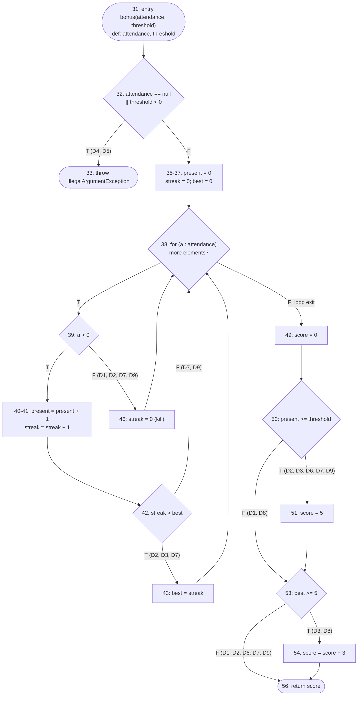

# Лаб 10: Өгөгдлийн урсгалын тестчилгээ

**Нэр:** Номунзаяа  **Оюутны код:** B232270804  **Хичээл:** F.CSA313

Бүгдийг `mvn verify` командаар ажиллуулна. JaCoCo тайлан: `target/site/jacoco/index.html`.
Мөрийн дугаарууд бүгд `DataFlowTargets.java`-ийн мөрүүд (эх кодыг өөрчлөөгүй). DU хосыг `var(def, use)` хэлбэрээр тэмдэглэв.

## Орчин

```
$ java -version
openjdk version "17.0.20.1" 2026-08-18
OpenJDK Runtime Environment (build 17.0.20.1+1-1-26.04-Ubuntu)
OpenJDK 64-Bit Server VM (build 17.0.20.1+1-1-26.04-Ubuntu, mixed mode, sharing)

$ mvn -version
Apache Maven 3.9.12
Maven home: /usr/share/maven
Java version: 17.0.20.1, vendor: Ubuntu, runtime: /usr/lib/jvm/java-17-openjdk-amd64
Default locale: en, platform encoding: UTF-8
OS name: "linux", version: "6.18.33.2-microsoft-standard-wsl2", arch: "amd64", family: "unix"
```

## A хэсэг: gcd-ийн DU хосууд

### Def/use (мөр 13–20)

| Мөр | Код | def | use |
|---|---|---|---|
| 13 | `gcd(int x, int y)` | x, y | — |
| 15 | `while (y != 0)` | — | y (p-use) |
| 16 | `tmp = x % y` | tmp | x, y (c-use) |
| 17 | `x = y` | x | y (c-use) |
| 18 | `y = tmp` | y | tmp (c-use) |
| 20 | `return x` | — | x (c-use) |

### Тестүүд (`GcdTest`)

| Тестийн ID | Оролт | Хүлээгдэх | Тайлбар |
|---|---|---|---|
| G1 | `gcd(7, 0)` | 7 | Давталт 0 удаа. x(13,20), y(13,15F) |
| G2 | `gcd(0, 5)` | 5 | Давталт 1 удаа: tmp = 0, x = 5, y = 0 |
| G3 | `gcd(12, 8)` | 4 | Давталт 2 удаа: 17, 18-д олсон утга дараагийн давталтад хэрэглэгдэнэ |

### DU хосын бүрэн хүснэгт (11 хос)

| # | Хувьсагч | def мөр | use мөр | c-use / p-use | Def-clear зам | Тестийн ID | Хамрагдсан эсэх |
|---|---|---|---|---|---|---|---|
| 1 | x | 13 | 16 | c | 13 → 15 (T) → 16 | G2 | Тийм (G2) |
| 2 | x | 13 | 20 | c | 13 → 15 (F) → 20 | G1 | Тийм (G1) |
| 3 | x | 17 | 16 | c | 17 → 18 → 15 → 16 | G3 | Тийм (G3) |
| 4 | x | 17 | 20 | c | 17 → 18 → 15 (F) → 20 | G2 | Тийм (G2) |
| 5 | y | 13 | 15 | p | 13 → 15 | G2 (T), G1 (F) | Тийм (G2 T, G1 F) |
| 6 | y | 13 | 16 | c | 13 → 15 (T) → 16 | G2 | Тийм (G2) |
| 7 | y | 13 | 17 | c | 13 → 15 (T) → 16 → 17 | G2 | Тийм (G2) |
| 8 | y | 18 | 15 | p | 18 → 15 | G3 (T), G2 (F) | Тийм (G3 T, G2 F) |
| 9 | y | 18 | 16 | c | 18 → 15 (T) → 16 | G3 | Тийм (G3) |
| 10 | y | 18 | 17 | c | 18 → 15 (T) → 16 → 17 | G3 | Тийм (G3) |
| 11 | tmp | 16 | 18 | c | 16 → 17 → 18 | G2 | Тийм (G2) |

3 тест 11 хосыг бүгдийг хамарна. `results/mvn-verify-gcd.txt`: Tests run: 3, Failures: 0.

## B хэсэг: bonus()

### B1 CFG



Зангилаа бүр мөрийн дугаартай, ирмэг дээр тухайн салбарыг дайрсан тестийн нэрийг бичсэн. 46-р мөр нь `streak`-ийн def-ийг устгана (kill).

Аль тест аль ирмэгийг хамрах вэ (`bonus()`-ийн шийдвэрийн салбарууд):

| Ирмэг | Хамарсан тест |
|---|---|
| 32 → throw (T) | D4 (`null` массив), D5 (`threshold = -1`) |
| 32 → 35 (F) | D1, D2, D3, D6, D7, D8, D9 |
| 38 → 39 (давталтад орно) | D1, D2, D3, D7, D8, D9 |
| 38 → 49 (давталт орохгүй / дуусна) | D6 (хоосон массив); бусад тест давталт дуусахад |
| 39 → 40 (T, `a > 0`) | D2, D3, D7, D8, D9 |
| 39 → 46 (F, `a <= 0`) | D1, D2, D7, D9 |
| 42 → 43 (T, `streak > best`) | D2, D3, D7, D8, D9 |
| 42 → 38 (F, `streak <= best`) | D7, D9 |
| 50 → 51 (T, `present >= threshold`) | D2, D3, D6, D7, D9 |
| 50 → 53 (F, `present < threshold`) | D1, D8 |
| 53 → 54 (T, `best >= 5`) | D3, D8 |
| 53 → 56 (F, `best < 5`) | D1, D2, D6, D7, D9 |

### B2 Def/use жагсаалт

| Мөр | Код | def | c-use | p-use |
|---|---|---|---|---|
| 31 | `bonus(attendance, threshold)` | attendance, threshold | — | — |
| 32 | `if (attendance == null \|\| threshold < 0)` | — | — | attendance, threshold |
| 35 | `present = 0` | present | — | — |
| 36 | `streak = 0` | streak | — | — |
| 37 | `best = 0` | best | — | — |
| 38 | `for (int a : attendance)` | a | — | attendance |
| 39 | `if (a > 0)` | — | — | a |
| 40 | `present = present + 1` | present | present | — |
| 41 | `streak = streak + 1` | streak | streak | — |
| 42 | `if (streak > best)` | — | — | streak, best |
| 43 | `best = streak` | best | streak | — |
| 46 | `streak = 0` (kill) | streak | — | — |
| 49 | `score = 0` | score | — | — |
| 50 | `if (present >= threshold)` | — | — | present, threshold |
| 51 | `score = 5` | score | — | — |
| 53 | `if (best >= 5)` | — | — | best |
| 54 | `score = score + 3` | score | score | — |
| 56 | `return score` | — | score | — |

Нийт 13 def (31-р мөр нь 2 гэж тооцогдоно: `attendance`, `threshold`).

### B3 DU хос ба kill

Нийт 23 DU хос. Kill багана нь тухайн def-ийг дараа нь дахин тодорхойлж устгах мөрүүдийг харуулна.

| # | Хувьсагч | def | use | c/p | Тест | Kill |
|---|---|---|---|---|---|---|
| 1 | attendance | 31 | 32 | p | D1 (F), D4 (T) | — |
| 2 | attendance | 31 | 38 | p | D1 (T, F), D6 (F) | — |
| 3 | threshold | 31 | 32 | p | D1 (F), D5 (T) | — |
| 4 | threshold | 31 | 50 | p | D2 (T), D1 (F) | — |
| 5 | a | 38 | 39 | p | D2 (T, F) | — |
| 6 | present | 35 | 40 | c | D2 | 40 (ашиглалтын мөр өөрөө, замын дундах биш) |
| 7 | present | 35 | 50 | p | D6 (T), D1 (F) | 40 |
| 8 | present | 40 | 40 | c | D3 | 40 (дараагийн давталт) |
| 9 | present | 40 | 50 | p | D2 (T), D8 (F) | 40 (дараагийн давталт) |
| 10 | streak | 36 | 41 | c | D3 | 41, 46 |
| 11 | streak | 41 | 41 | c | D3 | 41 (дараагийн давталт), 46 |
| 12 | streak | 46 | 41 | c | D2 | 41 |
| 13 | streak | 41 | 42 | p | D3 (T), D7 (F) | 41 (дараагийн давталт), 46 |
| 14 | streak | 41 | 43 | c | D2 | 41 (дараагийн давталт), 46 |
| 15 | best | 37 | 42 | p | D2 (T); F салбар боломжгүй | 43 |
| 16 | best | 37 | 53 | p | D1 (F); T салбар боломжгүй | 43 |
| 17 | best | 43 | 42 | p | D7 (T, F) | 43 (дараагийн давталт) |
| 18 | best | 43 | 53 | p | D3 (T), D2 (F) | 43 (дараагийн давталт) |
| 19 | score | 49 | 54 | c | D8 | 51, 54 |
| 20 | score | 49 | 56 | c | D1 | 51, 54 |
| 21 | score | 51 | 54 | c | D3 | 54 |
| 22 | score | 51 | 56 | c | D2 | 54 |
| 23 | score | 54 | 56 | c | D3, D8 | — |

**Боломжгүй салбарууд (15, 16-р хос).** 37-д `best = 0` үед анхны эерэг элемент дээр `streak = 1 > 0` үргэлж үнэн тул тухайн def-ээр 42-ын F салбар боломжгүй. Мөн `best = 0` үед 53-ын `best >= 5` үргэлж худал тул T салбар боломжгүй. Хос бүрийн зөвхөн боломжтой салбарыг хамрагдсанд тооцсон.

### B4 All-defs тестүүд ба яагаад энэ тоо хамгийн бага вэ

Ашигласан тестүүд (`BonusTest`):

| Тестийн ID | Оролт | Хүлээгдэх | Зорилго |
|---|---|---|---|
| D1 | `{0, -1, 0}`, 1 | 0 | Эерэг элемент байхгүй. score(49), present(35), best(37) |
| D2 | `{0, 1}`, 1 | 5 | Kill (46) дараа эерэг. streak(46,41), score(51,56) |
| D3 | `{1, 1, 1, 1, 1}`, 3 | 8 | 5 дараалсан эерэг. streak(36,41), score(51,54), score(54,56) |
| D4 | `null`, 3 | `IllegalArgumentException` | 32-ын T салбар |
| D5 | `{1}`, -1 | `IllegalArgumentException` | 32-ын T салбар (threshold) |
| D6 | `{}`, 0 | 5 | Давталт орохгүй |
| D7 | `{1, 1, 0, 1}`, 1 | 5 | 42-ын F салбар, streak дахин тэглэгдэнэ |
| D8 | `{1, 1, 1, 1, 1}`, 10 | 3 | Зөвхөн streak урамшуулал (present < threshold) |
| D9 | `{1, 1, 1, 1, 0, 1}`, 1 | 5 | present = 5, хамгийн урт цуваа = 4. M2-г илрүүлнэ |

**All-defs (D1–D3).** Энэ тайланд 3 тест ашигласан. Доод хэмжээ нь 2 тест. `score(49)`-ийн def нь 51-р мөрөөр устгагдах тул зөвхөн 50-р мөрийн F салбараар (present < threshold) use-д хүрнэ. `score(51)` нь зөвхөн 50-ийн T салбараар хүрнэ. Нэг тест 50-ийн хоёр салбарыг хоёуланг нь гүйж чадахгүй тул хамгийн багадаа 2 тест хэрэгтэй. D2 ба D3-ийн шаардлагыг нэг массивт багтааж болно: `{1, 1, 1, 1, 1, 0, 1}`, threshold 3 (хүлээгдэх 8). Энд 0-ийг 5 эерэгийн ард тавьсан, учир нь эхэнд тавьвал `streak(36)` kill-д өртөж 41-д хүрэхгүй. Энэ нэгтгэсэн багцыг гараар тооцсон боловч ажиллуулж баталгаажуулаагүй.

**All-du-pairs (D4–D8).** 23 хосыг бүгдийг хамрахын тулд нэмсэн. Жишээ нь `score(51)→56` (22-р хос) зөвхөн best < 5 үед хүрдэг тул D2 ба D3-ийг тусад нь үлдээсэн. D9 нь M2-г унагахаар нэмэгдсэн.

## JaCoCo: alldefs болон final

Тоонууд нь `results/jacoco-alldefs.csv` болон `results/jacoco-final.csv` файлаас авсан (`DataFlowTargets` класс).

| Багц | Тест | Branch (хамарсан / нийт) | Branch % | Line (хамарсан / нийт) | Line % |
|---|---|---|---|---|---|
| alldefs | D1–D3 | 13 / 16 | 81.25% | 22 / 24 | 91.67% |
| final | D1–D9 | 16 / 16 | 100% | 23 / 24 | 95.83% |

alldefs дээр хамрагдаагүй 3 салбар нь D4, D5, D7-д л хамрагддаг салбарууд байх магадлалтай: 32-ын `attendance == null`, `threshold < 0` нь үнэн болох хоёр салбар, мөн 42-ын F салбар (`streak <= best`). Эдгээрийг D4, D5, D7 нэмэхэд final дээр 100% болсон. final дээр үлдсэн 1 мөр нь `DataFlowTargets`-ийн анхдагч constructor байх магадлалтай, учир нь METHOD_MISSED = 1 хоёр багцад адил байна.

**Салбарын 100% хамрагдалт нь бүх DU хосыг хамарсан гэсэн үг үү?** Үгүй. Салбарын хамрагдалт нь шийдвэр бүрийн T, F хоёр талыг дор хаяж нэг удаа гүйсэн эсэхийг л шалгадаг, харин def нь аль use-д хүрсэн бэ гэдгийг шалгадаггүй.

Жишээ: D1–D7 тестүүдийг (D8, D9-гүйгээр) гүйлгэвэл B1-ийн ирмэгийн хүснэгт ёсоор 16 салбар бүгд хамрагдана (50-ын T нь D2, F нь D1, 53-ын T нь D3, F нь D1, 42-ын F нь D7, 32-ын хоёр T нь D4, D5). Гэсэн ч `score(49)→54` (19-р хос) uncovered хэвээр үлдэнэ: энэ хос нь 50-ийн F салбараар орж (present < threshold), дараа нь 53-ын T салбарт (best >= 5) хүрэх ёстой, ийм тест нь D8 юм. 50-ийн F салбар (D1), 53-ын T салбар (D3) тус тусдаа хамрагдсан ч тэдгээрийн *хослол* хамрагдаагүй байна.

## C хэсэг: Алдаа суулгах (Fault seeding)

Мутаци бүрийг `DataFlowTargets.java`-д хийж `mvn test` ажиллуулаад `git restore`-оор буцаасан (`git diff --stat src/main` хоосон).

| Мутант | Өөрчлөлт | Хэн унагасан | Үр дүн |
|---|---|---|---|
| M1 | 41-р мөрийг (`streak = streak + 1`) устгасан | D3 (хүлээгдэх 8, гарсан 5), D8 (хүлээгдэх 3, гарсан 0) | Устгагдсан (killed). Tests run: 11, Failures: 2 |
| M2 | 42–44-р мөр (`if (streak > best) { best = streak; }`) → `best = present;` | D9 | D1–D8-д амьд үлдсэн (Tests run: 11, Failures: 0). D9 нэмсний дараа устгагдсан (`results/mvn-test-M2-kill.txt`: Tests run: 12, Failures: 1, expected <5> but was <8>) |
| M3 | 48-р мөрийн дараа `int total = present + best;` нэмсэн | Байхгүй | Амьд үлдсэн (equivalent mutant). Tests run: 11, Failures: 0. VS Code-ийн статик шинжилгээ илрүүлсэн |

**M1.** streak ихсэхгүй тул best үргэлж 0 болж, 54-ийн +3 оноо алга болно. Тиймээс 5 дараалсан эерэгтэй D3, D8 унана.

**M2 яагаад all-DU тестүүдэд амьд үлдсэн бэ.** Анхны тестүүдэд present >= 5 байхад хамгийн урт цуваа мөн 5 байсан (D3, D8), эсвэл present < 5 байсан. Тиймээс `best = present` ба `best = streak` (хамгийн урт цуваа) ижил үр дүн өгсөн. Ялгаа нь present >= 5 боловч хамгийн урт цуваа 5-аас бага үед гарна. Үүнийг барих тест нь D9: `{1, 1, 1, 1, 0, 1}`, threshold 1. Энд present = 5, хамгийн урт цуваа = 4. Анхны код 5, M2 8 буцаасан тул D9 унана.

**M3.** `total` нь тодорхойлогдсон боловч хаана ч хэрэглэгдээгүй (dead definition) тул буцаах утга өөрчлөгдөхгүй. Тиймээс ямар ч тест барьж чадахгүй. DU хүснэгтэд энэ def-д хос байхгүй, учир нь use байхгүй. `mvn` дахь javac ямар ч WARN үзүүлээгүй (`results/mvn-test-M3.txt`). Харин VS Code-ийн дараах анхааруулгаар илэрсэн:

> The value of the local variable total is not used Java(536870973), source jdt.ls-java-project

Энэ нь IDE-ийн статик шинжилгээ (Eclipse JDT Language Server) бөгөөд javac-д гардаггүй. Тиймээс mvn-ийн гаралтад WARN байхгүй нь зөв.

## Дүгнэлт

DU анализ нь branch хамралтаас нарийвчлалтай: branch нь шийдвэрийн хоёр талыг л шаардаг бол DU нь утга хаана үүсч, хаана хэрэглэгдэхийг шаардана. gcd дээр G1 ба G2 нь branch-ийг 100% хамрах боловч 11 хосоос 4-ийг үлдээдэг. bonus() дээр all-defs-ийн доод хэмжээ 2 тест гэдгийг score(49) ба score(51)-ийн 50-р мөрийн зөрчилд үндэслэн батлах боломжтой. All-du-pairs-ийн 23 хосыг бүгдийг хамрахад 9 тест хэрэгтэй болсон. M2 шиг утгын алдаа (best = present) нь хосын хамралтаар илрэхгүй тул утгыг ялгах тест (D9) шаардсан. M3 шиг хэрэглэгдээгүй def нь DU хос үүсгэхгүй тул хамралтаар ч, тестээр ч илрэхгүй, зөвхөн статик шинжилгээ илрүүлнэ. Ийнхүү DU хамралт гараар их ажил шаардах боловч JaCoCo зөвхөн branch-ийг автоматаар хэмждэг. Иймээс DU хамралт, branch хамралт, статик шинжилгээ гурвыг хослуулах нь зөв.

